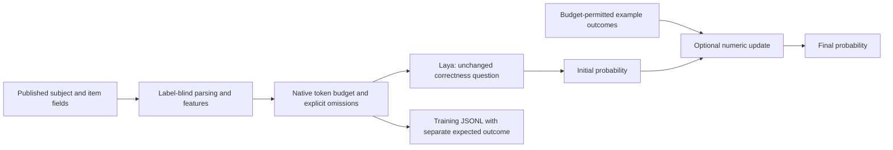

# Task-v2 inputs, structured features and evidence adaptation

Subsequent opt-in preparation: [compact-v3 inputs and development review](compact-inputs-and-development.md).
The task-v2 implementation/results below remain intact for historical contracts.

Implemented 2026-10-22 following the engineering review. This is a new versioned
pipeline, with preparation and checks on the frozen 5,000 training / 963
development response records. No new Laya inference, gradient training,
calibration fitting or confirmation scoring was performed. A separate numeric
control was scored using the existing saved head probabilities.

## High-level design



Preparation and inference call the same `TaskStateBuilder`. Model loading stays
in `laya_runtime.py`, independent of MLX versus PyTorch/MPS/CUDA. Source-field
projection stays in `competition.py`. Postprocessing stays in `evidence.py`.

The existing renderer files are pinned by historical checkpoint manifests.
They were left unchanged so the completed head and previous experiments retain
their input contracts. The new adapter is selected through
`make_laya_predictor`, with `task_v2` or `task_enriched_v2`. Existing defaults
continue to reproduce historical inputs; the new training recipe explicitly
selects the new pipeline.

## What upstream review established

Reviewed the [Laya repository](https://github.com/NandhaKishorM/laya),
[sequence builder](https://github.com/NandhaKishorM/laya/blob/main/laya/common.py),
[training implementation](https://github.com/NandhaKishorM/laya/blob/main/laya/train.py),
[fine-tuning guide](https://nandhakishorm.github.io/laya/finetune/) and
[routing guide](https://nandhakishorm.github.io/laya/routing/), alongside our
installed native packages and original pinned weights.

The native sequence builder reserves space for the question/options and then
keeps a prefix of the state by default. Our builder therefore measures actual
native token capacity, rather than treating 1,024 as the available state budget.
It checks the final serialization too. Upstream training/inference share the
same question representation, and our pipeline preserves that property. A
yes/no probability does not need an extra request to output a number.

Current upstream documentation discusses multilingual routing and diagnostics
for near-constant predictions. These motivate later controlled experiments;
they do not establish gains on our task. No package or encoder was silently
upgraded, no automatic language routing was added, and the head remains trained
with the existing weighted cross-entropy implementation.

## Task parsing and actual supplied context

The original pilot contains plain task text, message lists, `messages` objects,
`system`/`user` objects, and SQL objects with question, evidence and schema.
These are handled structurally, without consulting benchmark identities.

- Explicit question/query/task and recent user messages receive priority.
- Options/choices retain their field paths; other context and schema remain
  separately labeled. Supplied system instructions and earlier turns also remain
  represented, with a smaller share when the input cannot fit.
- Task-specific text gets most of the budget; target-system fields and recorded
  item features/interactors have separate bounded allocations. Short sections
  return unused capacity to longer ones.
- Long sections retain their beginning and end with an explicit omission marker.
  This prevents the BenGER common-prefix collapse. It can still miss important
  evidence in the middle, so omission flags remain essential.
- JSON with duplicate keys, malformed input and scalar strings remain literal.
  Very large or deeply nested structures fall back to literal text. This avoids
  spending the entire budget on hundreds of field paths or failing recursion.
- Character boundaries avoid splitting Unicode codepoints. Every final state
  is measured by the selected checkpoint's tokenizer and must fit its budget.

This is deterministic extraction and budgeting, not a learned summary or a
claim of lossless compression. Full source exports stay immutable and hashed.
The visible state and sidecar make any removal inspectable.

## Features and visibility records

`features.jsonl` has a homogeneous versioned record per source response:
`role`, `jsonl_line`, `row_id`, `features` and `visibility`. These audit identifiers
are not Laya input fields.

| Group | Implemented information |
| --- | --- |
| System | Canonical-name presence, recorded identifiers/settings, missing fields, identity-not-recorded flag |
| Task | Character/token length, CJK-character count, script hint, MCQ option-count hint, structural section count, interactors presence |
| Visibility | Actual state capacity/tokens, omissions for task/system/item attributes, per-section original/retained text tokens, structural fallback |
| Content integrity | Full and retained task-content hashes, separately from item metadata and IDs |

Compact script/option hints enter the state; the full feature dictionary is
also available to numerical controls. Script and option detection are heuristics,
not an inferred language certification or a correctness judgment. Unknown values
stay unknown. Recognizing a recorded identifier does not verify an exact model
checkpoint or make ambiguous aliases safe for architecture enrichment.

`task_enriched_v2` can append the existing allowlisted documented model/harness
facts only when they fit. It keeps the existing source-policy/catalog provenance
and research-only status. It does not turn documented supported tools into
enabled run settings. The baseline `task_v2` adds no external facts.

## Measured input effects

Saved preparation: `runs/head_finetuning/task_features_pilot_v2/`.

| Check | Prior enriched inputs | Task-v2 preparation |
| --- | ---: | ---: |
| Training records | 5,000 | 5,000, same records/outcomes |
| Development outcomes / system–item inputs | 963 / 960 | 963 / 960, same records |
| Rows in distinct-full-task / identical-whole-input groups | 654 | 0 |
| BenGER distinct retained whole inputs | 211 / 833 | 833 / 833 |
| Native prefix truncation of rendered training inputs | 2,042 | 0 |
| Training records with explicit task-text omissions | Previously not separated | 2,040 (40.8%) |

**Zero native truncation is not complete context retention.** We now do the
shortening explicitly and report it. Within the selected systems, ignoring item
metadata/IDs still leaves **34 ClashEval records** in groups with identical
retained task text but distinct full content. The corresponding BenGER count is
zero. This prevents a misleading claim of success based only on retained IDs.
Query-aware context selection or multiple views is a later experiment for those
long contexts; neither is claimed as implemented.

The unknown C-Eval identity problem remains. Equal allowed profiles must remain
equal; display names and private subject IDs are unavailable as repair features.

## Revealed-label adaptation and evaluation scope

The optional `beta_mean` rule computes:

```text
p_final = (k * p_initial + matching_revealed_successes)
          / (k + matching_revealed_count)
```

With no matching examples, the probability is unchanged. The default proposed
control uses **k=5**, explicitly recorded as untuned. This is a simple heuristic
combination of an item prior and an estimated system/benchmark rate; it is not
a learned task-conditioned Bayesian model. Numeric updating and appended text
examples cannot be enabled together.

Evidence matches all supplied subject fields plus anonymous benchmark ID. It
excludes entries identical to the target's visible item and does not accept
missing benchmark IDs as a global pool. It retains legitimate repeated observed
trials. No outcome is fetched by the predictor, and no target label enters it.

The [published interface](https://aims.stanford.edu/competition) allows mixed
evidence across sampled pairs. New numeric-evidence evaluations therefore use
`evaluate(shared_evidence=True)`. The historical evaluator's pair-local evidence
path remains available for reproducibility. For identical visible profiles,
mixed evidence stays ambiguous; the new path does not resolve it using scorer
subject IDs. This difference is logged in run details.

## Actual evidence-control result, using the existing checkpoint

Saved result: `runs/head_finetuning/evidence_control_v1/`. No Laya forward pass
was run. Reproduced the old zero-budget score exactly, then scored one fixed
update strength against the same frozen development targets and nested
acquisition pools. Matching uses only the visible fields, across all eight pairs.

| Predictor | Brier ALC |
| --- | ---: |
| Existing saved head, no update | 0.249080 |
| Existing saved head + numeric evidence, k=5 | **0.238145** |
| Constant 0.5 + numeric evidence, k=5 | 0.239531 |

The head-plus-evidence curve is 0.24908, 0.25886, 0.25782, 0.22529, 0.21442,
0.21958 at budgets 0/1/3/7/15/31. The earliest updates are worse on this
acquisition trajectory; later updates improve enough to lower ALC. Most of the
gain also occurs with a constant initial prior. This supports the adaptation
mechanism but does not establish a strong contribution from Laya.

This is the already-used development set, including checkpoint selection.
No strength search or calibration was fitted on it. Tune future strengths only
on training-family folds, and keep confirmation sealed. This result does **not**
measure the new task-v2 inputs, an unseen-family improvement, or a retrained head.

## Small control and the next training recipe

`feature_control.FeatureRidge` supplies a separate 326-feature Unicode character
n-gram / structured control, with explicit weighted training and a centered,
regularized linear fit. It keeps Chinese characters, unlike the historical
ASCII-only ridge. No automatic data selection, fitting, architecture lookup or
weight download occurs. Only synthetic unit-test fitting has run; no competition
quality result is claimed for this new control. Historical text-ridge behavior
and caches remain unchanged.

`configs/head_finetuning/task_features_pilot_v2.json` prepares matched baseline
and research-enriched variants, with **one epoch / 79 updates** for the first
future training comparison. It preserves the original 5,000 records, seed,
parent, token ceiling, precision, optimizer and batch settings, so input changes
can be assessed against the earlier epoch-one result. Checkpoint export bundles
the new contract; inference refuses to apply the new format to an old checkpoint.
Native PyTorch preparation checks verify every baseline/enriched input against
the shared renderer before training.

No training starts during preparation or ordinary preflight. A GPU launch and
encoder unfreezing have not occurred. Parameter reduction and language-aware
encoder comparisons remain subsequent experiments, rather than silent changes
to this input comparison.

## Commands

```bash
# Prepare inputs only; requires a fresh configured output directory.
.venv-laya-mlx/bin/python scripts/prepare_task_pilot.py

# Check native Torch rendering/tokens; no model weights loaded or inference.
.venv-laya/bin/python scripts/run_head_pilot.py \
  --config configs/head_finetuning/task_features_pilot_v2.json

# Future inference/evaluation with original weights and the new input builder.
# These commands RUN inference; they were not executed for this change.
.venv-laya-mlx/bin/python scripts/run_eval.py --suite smoke --predictor laya \
  --laya-state-format task_v2 --laya-max-len 1024 \
  --laya-evidence beta_mean --laya-evidence-strength 5 --out runs/NEW_EVAL

# Same options can be planned locally or on Modal; dry-run allocates no GPU.
.venv-modal/bin/python scripts/run_job.py --profile modal-l4 --task evaluate \
  --state-format task_v2 --evidence-mode beta_mean --out runs/NEW_MODAL_EVAL --dry-run
```

For the completed older checkpoint, leave its state format unspecified and add
only `--laya-evidence beta_mean`. Its bundled original input contract remains in
force. A later task-v2 checkpoint selects its matching format from its contract.

Competition-specific external-source eligibility remains unreviewed. The
dataset-only path is the recommended next baseline; no organizer contact or
runtime web lookup was added.

## Verification

The 221-test suite passes in both environments (MLX: nine expected skips;
PyTorch: one). New tests cover long common-prefix tasks, SQL context, Unicode,
large/malformed JSON, private-field exclusion, evidence matching, unchanged
base inputs across budgets, mixed-system evidence, native budget guards and
checkpoint/format mismatch rejection. Logs: `runs/task_pipeline_mlx_tests.log`
and `runs/task_pipeline_torch_tests.log`.

Native PyTorch preflight passes all training/development token and runtime-render
checks for both prepared variants, without loading model tensors. Logs:
`runs/task_features_torch_preflight.log`. Both local and Modal command plans
validate in dry-run mode; no cloud resource was created. The older prepared
experiment still verifies, and the downloaded best checkpoint still resolves
its original `enriched_v1` contract.
